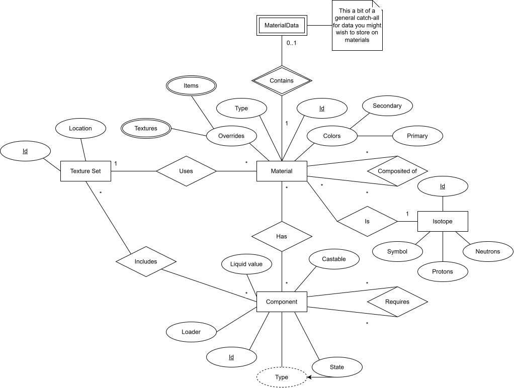

# Requirements Outline
This file will serve as a basis for features, outlining requirements and functionality of components

## Data structure
ER-diagram of the preferred data structure:

### Attribute types
What is the type of all of these attributes?

|Material|Type|
|-|-|
|Id|String (unique)|
|Type|Enum (premade)|
|Primary color|Hexcode (colorcode)|
|Secondary color|Hexcode (colorcode)|
|Composite|List\<Material> or Element|
|Item overrides|List\<ItemOverride>|
|Texture overrides|List\<TextureOverride>|

### Attribute access
How should we be able to adjust data once stored?

In general, the idea is to maximize configurability, allowing people to adjust as many attributes as we can without compromising data integrity

This means that we will allow users to do stuff that might seem highly volatile, as long as it would still allow the system to work

Legend:
- Set: Can override entire attribute
- Delete: Can remove entire attribute
- Add: Can append data to list type structures
- Remove: Can remove data from list type structures

|Material|Set|Delete|Add|Remove|
|-|-|-|-|-|
|Id|||||
|Type|X|X|||
|Primary color|X||||
|Secondary color|X|X|||
|Composite|X|X|X|X|
|Item overrides|X|X|X|X|
|Texture overrides|X|X|X|X|

|Component|Set|Delete|Add|Remove|
|-|-|-|-|-|
|Id|||||
|State|X||||
|Loader|X||||
|Castable|X|X|||
|Liquid value|X|X|||
|Dependencies|X|X|X|X|

|Texture Set|Set|Delete|Add|Remove|
|-|-|-|-|-|
|Id|||||
|Location|X|X|||

|Isotope|Set|Delete|Add|Remove|
|-|-|-|-|-|
|Id|||||
|Symbol|X|X|||
|Protons|X|X|||
|Neutrons|X|X|||